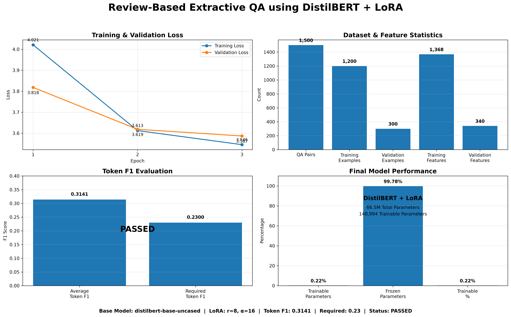

# Review-Based Extractive QA using DistilBERT + LoRA

A transformer-based extractive Question Answering system trained on
review-based question-answer pairs using **DistilBERT** and **LoRA
(Low-Rank Adaptation)**.

The project takes a question and a review/context passage and extracts
the most relevant answer span directly from the context.



## Overview

This project implements an end-to-end extractive Question Answering
pipeline:

1.  Load and explore the review-based QA dataset.
2.  Clean and validate answer character spans.
3.  Split the data into training and validation sets.
4.  Tokenize questions and contexts using DistilBERT.
5.  Handle long contexts using overlapping sliding windows.
6.  Fine-tune DistilBERT for extractive Question Answering.
7.  Apply LoRA through PEFT for parameter-efficient fine-tuning.
8.  Train using the Hugging Face Trainer.
9.  Extract answer spans from start/end logits.
10. Evaluate predictions using Token F1.
11. Save the trained LoRA adapter and tokenizer.

## Key Results

  Metric                                         Result
  ------------------------- ---------------------------
  Total QA pairs                                  1,500
  Training examples                               1,200
  Validation examples                               300
  Training features                               1,368
  Validation features                               340
  Base model                  `distilbert-base-uncased`
  Maximum sequence length                           384
  Document stride                                   128
  LoRA rank                                           8
  LoRA alpha                                         16
  LoRA dropout                                      0.1
  LoRA target modules                  `q_lin`, `v_lin`
  Epochs                                              3
  Learning rate                                    2e-4
  Batch size                                          8
  Total parameters                           66,513,412
  Trainable parameters                          148,994
  Trainable percentage                           0.224%
  Final training loss                            3.8944
  Final validation loss                          3.5869
  **Validation Token F1**                    **0.3141**
  Required Token F1                              0.2300
  **Assignment Status**                      **PASSED**

The final Token F1 of **0.3141** exceeds the required threshold of
**0.23**.

## Dataset

The dataset contains **1,500 question-answer pairs** collected across
six review domains:

-   Books
-   Electronics
-   Grocery
-   Movies
-   Restaurants
-   Tripadvisor

Each domain contains 250 examples.

### Dataset columns

``` text
question
context
answer_text
answer_start
domain
```

An additional `answer_end` field is created during preprocessing:

``` text
answer_end = answer_start + len(answer_text)
```

## Data Distribution

The dataset is balanced across the six domains:

  Domain           Examples
  ------------- -----------
  Books                 250
  Electronics           250
  Grocery               250
  Movies                250
  Restaurants           250
  Tripadvisor           250
  **Total**       **1,500**

The data is split into:

``` text
Training   : 1,200
Validation : 300
```

The same domain distribution is maintained in both splits.

## Preprocessing

### Answer Span Validation

Each answer is checked against its corresponding context using:

``` text
answer_start
answer_end
```

Invalid character spans are corrected before tokenization.

### Sliding Window Tokenization

Long review contexts may exceed DistilBERT's input length. To handle
them, the project uses:

``` text
MAX_LENGTH = 384
DOC_STRIDE = 128
```

The tokenizer uses:

``` python
tokenizer(
    question,
    context,
    max_length=384,
    truncation="only_second",
    stride=128,
    return_overflowing_tokens=True,
    return_offsets_mapping=True
)
```

This converts:

``` text
1,200 training examples → 1,368 training features
300 validation examples → 340 validation features
```

The overlapping windows allow answers near the boundaries of long
contexts to remain available to the model.

## Model Architecture

The base model is:

``` text
distilbert-base-uncased
```

with the Question Answering head:

``` text
DistilBertForQuestionAnswering
```

The model produces:

``` text
start_logits
end_logits
```

For each input token, the model estimates the probability that the token
represents:

-   the beginning of the answer
-   the end of the answer

The highest-scoring valid start/end span is selected as the predicted
answer.

## LoRA / PEFT

Instead of fine-tuning every DistilBERT parameter, the project uses
**LoRA** through the PEFT library.

Configuration:

``` python
LoraConfig(
    task_type=TaskType.QUESTION_ANS,
    r=8,
    lora_alpha=16,
    lora_dropout=0.1,
    target_modules=["q_lin", "v_lin"],
    bias="none"
)
```

### Parameter Efficiency

``` text
Total parameters      : 66,513,412
Trainable parameters  :    148,994
Trainable percentage  :      0.2240%
```

This means the vast majority of the pretrained DistilBERT parameters
remain frozen while only a small set of LoRA parameters and the required
task components are trained.

## Training

Training is performed using the Hugging Face `Trainer`.

Configuration:

``` text
Epochs                  : 3
Learning rate           : 0.0002
Training batch size     : 8
Evaluation batch size   : 8
Weight decay            : 0.01
Maximum sequence length : 384
Document stride         : 128
```

### Training Progress

    Epoch   Training Loss   Validation Loss
  ------- --------------- -----------------
        1          4.0208            3.8182
        2          3.6125            3.6187
        3          3.5455            3.5869

The validation loss decreased throughout training, indicating that the
model learned useful QA representations without obvious validation-loss
degradation.

## Evaluation

The main evaluation metric is **Token F1**.

Token F1 compares the predicted answer tokens with the ground-truth
answer tokens.

The final result:

``` text
Validation Token F1 : 0.3141
Required Token F1   : 0.2300
```

### Result

``` text
0.3141 > 0.2300
```

Therefore:

``` text
FINAL STATUS: PASSED
```

## Sample Predictions

The notebook includes validation examples showing:

-   Domain
-   Question
-   Actual answer
-   Predicted answer
-   Token F1

Example:

``` text
Question:
How is the hotel?

Actual:
Hotel was clean

Predicted:
Hotel was clean, spacious

Token F1:
0.8571
```

The examples demonstrate that the model can extract semantically
relevant answer spans even when the prediction is not an exact
character-for-character match.

## Visualizations

The project includes a consolidated dashboard:

``` text
images/review_qa_project_dashboard.png
```

It summarizes:

-   Training and validation loss
-   Dataset and feature statistics
-   Token F1 performance
-   LoRA parameter efficiency

Additional visualizations can be stored in the `images/` directory.

Recommended project assets:

``` text
images/
├── review_qa_project_dashboard.png
├── training_validation_loss.png
├── token_f1_distribution.png
├── sample_prediction_f1.png
└── project_architecture.png
```

## Project Structure

``` text
Review-Based-Extractive-QA-LoRA/
│
├── Review-Based-Extractive-QA-using-Transfer-Learning.ipynb
├── subjqa_dataset.csv
│
├── images/
│   ├── review_qa_project_dashboard.png
│   ├── training_validation_loss.png
│   ├── token_f1_distribution.png
│   ├── sample_prediction_f1.png
│   └── project_architecture.png
│
├── subjqa_distilbert_lora/
│   ├── adapter_config.json
│   ├── adapter_model.safetensors
│   ├── tokenizer.json
│   ├── tokenizer_config.json
│   └── README.md
│
├── README.md
├── requirements.txt
├── .gitignore
└── LICENSE
```

## Installation

Create and activate a Python environment:

``` bash
conda create -n mlproject python=3.12
conda activate mlproject
```

Install the required packages:

``` bash
pip install torch
pip install transformers
pip install datasets
pip install peft
pip install accelerate
pip install pandas
pip install numpy
pip install matplotlib
```

Alternatively:

``` bash
pip install -r requirements.txt
```

## Running the Project

Open the notebook:

``` bash
jupyter notebook
```

Then run:

``` text
Review-Based-Extractive-QA-using-Transfer-Learning.ipynb
```

The notebook performs the complete workflow from dataset preparation
through model training and evaluation.

## Loading the Saved LoRA Adapter

The trained adapter can be loaded with the base DistilBERT Question
Answering model:

``` python
from transformers import AutoTokenizer, AutoModelForQuestionAnswering
from peft import PeftModel

base_model = AutoModelForQuestionAnswering.from_pretrained(
    "distilbert-base-uncased"
)

tokenizer = AutoTokenizer.from_pretrained(
    "./subjqa_distilbert_lora"
)

model = PeftModel.from_pretrained(
    base_model,
    "./subjqa_distilbert_lora"
)
```

The saved directory contains the LoRA adapter weights and tokenizer
configuration.

## Technologies Used

-   Python
-   PyTorch
-   Hugging Face Transformers
-   Hugging Face Datasets
-   PEFT
-   LoRA
-   DistilBERT
-   Pandas
-   NumPy
-   Matplotlib
-   Jupyter Notebook

## Key Concepts Demonstrated

This project demonstrates practical understanding of:

-   Natural Language Processing
-   Extractive Question Answering
-   Transfer Learning
-   Transformer architectures
-   DistilBERT
-   Tokenization
-   Sliding-window preprocessing
-   Character-to-token span alignment
-   Start/end answer logits
-   Parameter-Efficient Fine-Tuning
-   LoRA
-   PEFT
-   Hugging Face Trainer
-   Model evaluation
-   Token F1
-   Answer span extraction

## Why LoRA?

Full fine-tuning updates all model parameters and can require
substantially more memory and computation.

LoRA instead learns small low-rank update matrices while keeping most
pretrained parameters frozen.

In this project:

``` text
66,513,412 total parameters
148,994 trainable parameters
0.2240% trainable
```

This makes the fine-tuning process considerably more parameter-efficient
while retaining the pretrained knowledge of DistilBERT.

## Limitations

-   The dataset contains only 1,500 QA pairs.
-   Some questions have ambiguous or subjective answers.
-   Token F1 can be low when a semantically correct prediction uses
    different wording from the reference answer.
-   The model is designed for extractive QA and therefore selects
    answers from the supplied context rather than generating completely
    new answers.
-   Long contexts require sliding-window processing, which increases the
    number of model features.

## Future Improvements

Possible extensions include:

-   Larger review-based QA datasets
-   SQuAD-style mixed-domain training
-   Larger transformer backbones
-   Improved answer-span post-processing
-   Beam search over candidate spans
-   Confidence scoring
-   Exact Match and additional QA metrics
-   Domain-specific evaluation
-   Quantized inference
-   LoRA hyperparameter experimentation
-   Deployment through FastAPI
-   Interactive Question Answering web application

## Conclusion

This project demonstrates an end-to-end **Review-Based Extractive
Question Answering system using DistilBERT and LoRA**.

The final model achieved:

``` text
Token F1 = 0.3141
```

against a required minimum of:

``` text
Token F1 = 0.2300
```

The model therefore successfully meets the assignment requirement while
training only **0.224% of the total model parameters**.

------------------------------------------------------------------------

## Author

**Ebbeju Lankapalli**

B.Tech --- Computer Science and Engineering (AI & ML)

GitHub: `Ebbeju-Lankapalli`
